# 03 · Pantallas y flujos

Tabla generada desde las pantallas (es la fuente de verdad para textos y números de progreso). Vista previa: `preview/<archivo>.html`; fuente: `pantallas/<archivo>.dc.html`.

## Referencia

| Archivo | Pantalla | Tipo de tarjeta | Texto principal | Dominio | Sello | Ayuda | Pasos hechos |
|---|---|---|---|---|---|---|---|
| `Componentes` | Componentes v2.0 | hoja de componentes | Hoja de referencia del sistema | — | — | — | — |
| `Main` | Auditoría v1.6 (antecedente) | antecedente | Auditoría de diseño (antecedente v1.6) | — | — | — | — |

## Recorrido A · camino principal

| Archivo | Pantalla | Tipo de tarjeta | Texto principal | Dominio | Sello | Ayuda | Pasos hechos |
|---|---|---|---|---|---|---|---|
| `A-01-inicio` | 01 Inicio | inicio + historial | ¿Qué querés hacer hoy? | — | — | — | — |
| `A-02-que-documento` | 02 ¿Qué documento? | pregunta | ¿Qué documento querés renovar? | — | — | — | — |
| `A-03-pais` | 03 ¿Es en Uruguay? | pregunta | ¿Es en Uruguay? | — | — | — | — |
| `A-04-abriendo` | 04 Abriendo el sitio | espera | Estoy mirando la página… | agenda.ejemplo.gub.uy | Sitio oficial | abierta | — |
| `A-05-opciones` | 05 ¿Qué querés hacer acá? | opciones | ¿Qué querés hacer acá? | agenda.ejemplo.gub.uy | Sitio oficial | abierta | — |
| `A-06-guia` | 06 Sacar turno | paso_clic | Hacé clic en el botón «Sacar turno». | agenda.ejemplo.gub.uy | Sitio oficial | abierta | — |
| `A-07-verificando` | 07 Verificando | espera | Estoy fijándome si funcionó… | agenda.ejemplo.gub.uy | Sitio oficial | abierta | 1 |
| `A-07B-oficina` | 07B Oficina | paso_elegir | Elegí una oficina en «Oficina». | agenda.ejemplo.gub.uy | Sitio oficial | abierta | 1 |
| `A-07C-horario` | 07C Horario | paso_elegir | Elegí un horario en «Turnos disponibles». | agenda.ejemplo.gub.uy | Sitio oficial | abierta | 2 |
| `A-07D-continuar` | 07D Continuar | paso_clic | Hacé clic en «Continuar». | agenda.ejemplo.gub.uy | Sitio oficial | abierta | 3 |
| `A-14-pregunta-guia` | 14 Para mí | pregunta + paso_clic | Hacé clic en «Para mí». | agenda.ejemplo.gub.uy | Sitio oficial | abierta | 4 |
| `A-08-dato` | 08 Número de documento | paso_escribir | Escribí tu número en «Número de documento». | agenda.ejemplo.gub.uy | Sitio oficial | abierta | 5 |
| `A-08B-nacimiento` | 08B Fecha de nacimiento | paso_escribir | Escribí tu fecha en «Fecha de nacimiento». | agenda.ejemplo.gub.uy | Sitio oficial | abierta | 6 |
| `A-08C-continuar` | 08C Continuar | paso_clic | Hacé clic en «Continuar». | agenda.ejemplo.gub.uy | Sitio oficial | abierta | 7 |
| `A-08D-confirmar` | 08D Confirmar reserva | paso_clic | Hacé clic en «Confirmar reserva». | agenda.ejemplo.gub.uy | Sitio oficial | abierta | 8 |
| `A-09-listo` | 09 Listo | estado_exito | Listo: tu turno quedó reservado. | agenda.ejemplo.gub.uy | Sitio oficial | abierta | — |

## Recorrido A · desvíos

| Archivo | Pantalla | Tipo de tarjeta | Texto principal | Dominio | Sello | Ayuda | Pasos hechos |
|---|---|---|---|---|---|---|---|
| `A-10-no-se-bien` | 10 No sé bien | recomendacion | Te recomiendo este sitio | — | — | — | — |
| `A-11-otras-opciones` | 11 Otras opciones | opciones | Otras cosas que se pueden hacer | agenda.ejemplo.gub.uy | Sitio oficial | abierta | — |
| `A-12-achicada` | 12 Tarjeta achicada | tarjeta achicada | Hacé clic en «Sacar turno». | agenda.ejemplo.gub.uy | Sitio oficial | abierta | — |
| `A-13-error-pagina` | 13 Error de la página | estado_aviso + paso_elegir | La página marcó un error | agenda.ejemplo.gub.uy | Sitio oficial | abierta | 3 |
| `A-15-pausa` | 15 Pausa | pausa | Pausé la ayuda | agenda.ejemplo.gub.uy | Sitio oficial | pausa | — |
| `A-16-pudiste` | 16 ¿Pudiste terminar? | pudiste_terminar | ¿Pudiste terminar? | agenda.ejemplo.gub.uy | Sitio oficial | abierta | — |
| `A-17-todavia-no` | 17 Todavía no | pregunta | Sigamos. ¿Qué pasó? | agenda.ejemplo.gub.uy | Sitio oficial | abierta | — |
| `A-18-paso-faltante` | 18 Paso que faltaba | paso_clic | Hacé clic en «Confirmar reserva». | agenda.ejemplo.gub.uy | Sitio oficial | abierta | 8 |
| `N-32-cierre` | 32 Cierre sin evidencia | cierre sin evidencia | Bien. Gracias por avisarme. | agenda.ejemplo.gub.uy | Sitio oficial | abierta | — |
| `A-19-error-mostrame` | 19 Error de Guíame | error_guiame | No pude leer esta página | agenda.ejemplo.gub.uy | Sitio oficial | abierta | — |
| `A-20-no-soportada` | 20 No soportada | no_soportada | Acá no puedo guiarte | agenda.ejemplo.gub.uy | Sitio oficial | abierta | — |
| `A-21-salio` | 21 Salió de la ayuda | ayuda cerrada | Saliste de la ayuda. La página sigue igual. | agenda.ejemplo.gub.uy | Sitio oficial | cerrada | — |
| `A-22-volver-inicio` | 22 ¿Volver al inicio? | diálogo | ¿Volver al inicio? (sobre la pantalla 08) | agenda.ejemplo.gub.uy | Sitio oficial | abierta | 5 |

## Ingreso con usuario

| Archivo | Pantalla | Tipo de tarjeta | Texto principal | Dominio | Sello | Ayuda | Pasos hechos |
|---|---|---|---|---|---|---|---|
| `N-25-iniciar-sesion` | 25 Usuario | paso_escribir | Escribí tu cédula en «Usuario o cédula». | agenda.ejemplo.gub.uy | Sitio oficial | abierta | 1 |
| `N-25B-contrasena` | 25B Contraseña | paso_escribir | Escribí tu contraseña en «Contraseña». | agenda.ejemplo.gub.uy | Sitio oficial | abierta | 2 |
| `N-25C-ingresar` | 25C Ingresar | paso_clic | Hacé clic en «Ingresar». | agenda.ejemplo.gub.uy | Sitio oficial | abierta | 3 |
| `N-26-codigo` | 26 Código | paso_escribir | Escribí el código en «Código». | agenda.ejemplo.gub.uy | Sitio oficial | abierta | 4 |
| `N-26B-verificar` | 26B Verificar | paso_clic | Hacé clic en «Verificar». | agenda.ejemplo.gub.uy | Sitio oficial | abierta | 5 |

## Recorrido B · compra

| Archivo | Pantalla | Tipo de tarjeta | Texto principal | Dominio | Sello | Ayuda | Pasos hechos |
|---|---|---|---|---|---|---|---|
| `B-C01-busqueda` | C01 Búsqueda | inicio | ¿Qué querés hacer hoy? | — | — | — | — |
| `B-C02-que-hacer` | C02 ¿Qué querés hacer? | pregunta | ¿Qué querés hacer con la MacBook? | — | — | — | — |
| `B-C03-nueva-usada` | C03 ¿Nueva o usada? | pregunta | ¿La querés nueva o usada? | — | — | — | — |
| `B-C04-tiendas` | C04 Tienda recomendada | recomendacion | Te recomiendo esta tienda | — | — | — | — |
| `B-C04B-abriendo` | C04B Abriendo la tienda | espera | Estoy mirando la página… | tiendamac.ejemplo.com.uy | La tienda que elegiste | abierta | — |
| `B-C05-opciones-producto` | C05 ¿Es esta? | opciones | ¿Es esta la que querés? | tiendamac.ejemplo.com.uy | La tienda que elegiste | abierta | — |
| `B-C06-carrito` | C06 Agregar al carrito | paso_clic | Hacé clic en «Agregar al carrito». | tiendamac.ejemplo.com.uy | La tienda que elegiste | abierta | — |
| `B-C07-revisar-carrito` | C07 Revisar carrito | paso_clic + cita | Si está bien, hacé clic en «Finalizar compra». | tiendamac.ejemplo.com.uy | La tienda que elegiste | abierta | 1 |
| `B-C08-direccion` | C08 Dirección | paso_escribir | Escribí tu dirección en «Calle y número». | tiendamac.ejemplo.com.uy | La tienda que elegiste | abierta | 2 |
| `B-C08B-continuar-pago` | C08B Continuar al pago | paso_clic | Hacé clic en «Continuar al pago». | tiendamac.ejemplo.com.uy | La tienda que elegiste | abierta | 3 |
| `B-C09-pago` | C09 Número de tarjeta | paso_escribir + verificación de tienda | Escribí el número en «Número de tarjeta». | tiendamac.ejemplo.com.uy | La tienda que elegiste | abierta | 4 |
| `B-C09C-codigo` | C09C Código de seguridad | paso_escribir | Escribí los 3 números en «Código de seguridad». | tiendamac.ejemplo.com.uy | La tienda que elegiste | abierta | 5 |
| `B-C09B-revisar-pedido` | C09B Revisar pedido | paso_clic | Hacé clic en «Revisar pedido». | tiendamac.ejemplo.com.uy | La tienda que elegiste | abierta | 6 |
| `B-C10-confirmar` | C10 Confirmar compra | estado_aviso + paso_clic | Este botón hace la compra | tiendamac.ejemplo.com.uy | La tienda que elegiste | abierta | — |
| `B-C11-confirmada` | C11 Compra confirmada | estado_exito | Listo: tu compra quedó hecha. | tiendamac.ejemplo.com.uy | La tienda que elegiste | abierta | — |

## Recorrido B · desvíos

| Archivo | Pantalla | Tipo de tarjeta | Texto principal | Dominio | Sello | Ayuda | Pasos hechos |
|---|---|---|---|---|---|---|---|
| `N-C12-pago-rechazado` | C12 Pago rechazado | estado_aviso + opciones | La tienda rechazó el pago | tiendamac.ejemplo.com.uy | La tienda que elegiste | abierta | — |
| `N-C15-sitio-dudoso` | C15 Sitio no verificado | estado_aviso (sitio no verificado) | Esta no es la tienda que elegiste | tiendamac-ofertas.ejemplo.shop | No verificado | abierta | — |

## Recorridos

- **A, camino principal:** 01 → 02 → 03 → 04 → 05 → 06 → 07 → 07B → 07C → 07D → 14 → 08 → 08B → 08C → 08D → 09.
- **A, desvíos:**
  - 10, desde «No sé bien» (02/03) → «Ir con ayuda» lleva a 04.
  - 11, desde «Ver otras opciones» (05); «Volver a las 3 opciones» vuelve a 05.
  - 12, al tocar «Achicar» en cualquier paso; «Ver la ayuda» vuelve al paso.
  - 13, si tocó Continuar sin elegir oficina → vuelve a guiar «Oficina».
  - 15, si navegó por su cuenta; «Volver a donde estábamos» retoma el último paso.
  - 16 → 17 → 18. Desde 16, «Sí, terminé» lleva a 32.
  - 19 (error de Guíame), 20 (página no soportada), 21 (salió de la ayuda), 22 (confirmación antes de ir al inicio).
- **Ingreso con usuario**, si la página lo pide después de 06: 25 → 25B → 25C → 26 → 26B y retoma el camino.
- **B:** C01 → C02 → C03 → C04 → C04B → C05 → C06 → C07 → C08 → C08B → C09 → C09C → C09B → C10 → C11.
- **B, desvíos:** C12 (pago rechazado) desde C10; C15 (sitio no verificado) cuando el dominio deja de ser la tienda elegida.

## Diagrama (camino principal A)

```mermaid
flowchart LR
  A01[01 Inicio] --> A02[02 ¿Qué documento?] --> A03[03 ¿Uruguay?] --> A04[04 Abriendo] --> A05[05 Opciones] --> A06[06 Sacar turno]
  A06 --> A07[07 Verificando] --> A07B[07B Oficina] --> A07C[07C Horario] --> A07D[07D Continuar] --> A14[14 Para mí]
  A14 --> A08[08 Documento] --> A08B[08B Nacimiento] --> A08C[08C Continuar] --> A08D[08D Confirmar] --> A09[09 Listo]
  A02 -. No sé bien .-> A10[10 Recomendación] --> A04
  A05 -. otras .-> A11[11 Otras opciones] --> A05
  A07D -. error .-> A13[13 Error de la página] --> A07B
  A08D -. sin evidencia .-> A16[16 ¿Pudiste?]
  A16 -- Sí --> N32[32 Cierre] 
  A16 -- Todavía no --> A17[17 ¿Qué pasó?] --> A18[18 Paso faltante] --> A09
```

